# Implementation Plan & Quality Assurance Test Suite
## Badminton Live (ShuttleLive) — Multi-Tenant & Custom Branding Release

**Document Version:** 1.2.0  
**Status:** Draft — Pending Review  
**Target Window:** Core MVP Launch (Tomorrow's College Championship Pilot)

---

## 1. Phased Development Roadmap

```mermaid
gantt
    title ShuttleLive Development Roadmap (Multi-Tenant & Branding)
    dateFormat  HH:mm
    axisFormat  %H:%M
    section Phase 1
    Multi-Tenant Schema & Auth         :00:00, 45m
    section Phase 2
    Tournament & Branding Engine       :00:45, 60m
    section Phase 3
    Draws, Brackets & Court Scheduling :01:45, 60m
    section Phase 4
    Authoritative Scoring Engine & UI  :02:45, 90m
    section Phase 5
    Branded Microsite & Real-Time Sync :04:15, 90m
    section Phase 6
    QA Suite (28 Test Cases)           :05:45, 60m
```

### Phase 1: Multi-Tenant Architecture & Auth (Est. 45 min)
- [ ] Initialize Supabase project; apply migration with `organizations`, `tournaments`, `tournament_branding`, `matches`, `match_events`.
- [ ] Deploy PostgreSQL Stored Procedure `record_point_event()` for atomic, server-authoritative scoring.
- [ ] Enable PostgreSQL `pg_trgm` extension for fuzzy platform search.
- [ ] Configure Supabase Row Level Security (RLS) policies for cross-tenant isolation and umpire authorization.
- [ ] Setup Supabase Storage buckets: `tournament-assets`, `organization-assets`, `player-avatars` with public read policies.
- [ ] Implement Supabase Auth (Email/password, Google OAuth, and umpire Magic Link / 6-digit OTP fast-pass).

### Phase 2: Tournament Creation & Branding Studio (Est. 60 min)
- [ ] **[P0]** Build Generic Tournament Creation Wizard (Independent of specific college branding).
- [ ] **[P0]** Implement Logo & Cover Banner upload to Supabase Storage with on-the-fly Image Transformation (`?width=400&format=webp`).
- [ ] **[P0]** Implement unique slug generation and reservation system (`/t/[slug]`).
- [ ] **[P0]** Implement Player & Team creation (Singles and Doubles pair builder).
- [ ] **[P0]** Implement Category rules presets (`BWF_STANDARD` 3x21, `BAI_DOMESTIC` 3x15, `QUICK_21`, `SHORT_15`).
- [ ] **[P1]** Implement Appearance Studio color picker and section visibility toggles.
- [ ] **[P1]** Implement Sponsors & Partners upload strip.

### Phase 3: Draws, Bracketing & Scheduling (Est. 60 min)
- [ ] **[P0]** Implement Knockout bracket generator with power-of-2 byes calculation.
- [ ] **[P0]** Implement Manual Fixture creation and bracket slot assignment.
- [ ] **[P0]** Implement Court scheduling with double-booking prevention.
- [ ] **[P0]** Implement Player scheduling overlap warning.
- [ ] **[P1]** Implement Bronze Medal (Third-place match) toggle.

### Phase 4: Scoring Engine & Referee Interface (Est. 90 min)
- [ ] **[P0]** Connect unified command endpoint `POST /api/matches/:matchId/events` to Supabase `record_point_event()` RPC.
- [ ] **[P0]** Implement authoritative scoring state machine (BWF 3x21 + BAI 3x15, deuce, cap, intervals).
- [ ] **[P0]** Implement append-only `UNDO` rollback mechanism without data deletion.
- [ ] **[P0]** Implement `MATCH_WON_PENDING` confirmation state.
- [ ] **[P0]** Build mobile-first single-tap referee UI ($>48\text{px}$ touch targets).
- [ ] **[P0]** Implement optimistic concurrency versioning (`expectedVersion`, `clientEventId`, `409 Conflict`).
- [ ] **[P0]** Handle Walkover, Retirement, and Disqualification termination protocols.

### Phase 5: Branded Public Microsite & Real-Time Sync (Est. 90 min)
- [ ] **[P0]** Build public branded microsite route `/t/[slug]` with custom header, logo, banner, and venue details.
- [ ] **[P0]** Render subtle *"Powered by ShuttleLive"* badge in header and footer.
- [ ] **[P0]** Implement Tri-Mode Supabase Realtime: Broadcast (<100ms ephemeral updates) + Postgres CDC (canonical updates) + Presence.
- [ ] **[P0]** Implement Edge-cached HTTP polling fallback ($2.5\text{s}$ interval).
- [ ] **[P0]** Implement WhatsApp 1-tap sharing and dynamic OpenGraph preview cards.
- [ ] **[P1]** Implement Post-Event Hall of Fame & Champions Showcase for completed tournaments.
- [ ] **[P1]** Implement deterministic fact-based text commentary.
- [ ] **[P1]** Implement stadium projector / fullscreen scoreboard.
- [ ] **[P0]** Implement Edge-cached HTTP polling fallback ($2.5\text{s}$ interval).
- [ ] **[P0]** Implement WhatsApp 1-tap sharing and dynamic OpenGraph preview cards.
- [ ] **[P1]** Implement Post-Event Hall of Fame & Champions Showcase for completed tournaments.
- [ ] **[P1]** Implement deterministic fact-based text commentary.
- [ ] **[P1]** Implement stadium projector / fullscreen scoreboard.

### Phase 6: QA Verification & Acceptance Testing (Est. 60 min)
- [ ] Execute full 28-point QA acceptance suite (TC-01 through TC-28).
- [ ] Verify multi-tenant tenant isolation and asset security policies.

---

## 2. Launch Acceptance QA Checklist (28 Test Cases)

| Test ID | Area | Scenario / Action | Expected Result | Status |
| :---: | :--- | :--- | :--- | :---: |
| **TC-01** | Scoring | Score reaches 20–20 in 3x21 format. | Game enters deuce; indicates "Win by 2 points". | 🔲 |
| **TC-02** | Scoring | Score reaches 21–20 in deuce. | Game continues; 21 is NOT declared winner. | 🔲 |
| **TC-03** | Scoring | Score reaches 22–20 in deuce. | Game finishes cleanly; Side A declared Game 1 winner. | 🔲 |
| **TC-04** | Scoring | Score reaches 29–29; Side A scores next (30–29). | Game finishes immediately on sudden death cap (30 pts). | 🔲 |
| **TC-05** | Scoring (BAI) | 3x15 format: score reaches 20–20; Side B scores (21–20). | Game finishes immediately on BAI cap of 21 points. | 🔲 |
| **TC-06** | Service | Game 1 won by Side A; Game 2 begins. | Side A serves first in Game 2 from Right Service Court. | 🔲 |
| **TC-07** | Undo Engine | Umpire scores 21st game-winning point, then clicks Undo. | Score rolls back to 20–19; game reopens cleanly; no data lost. | 🔲 |
| **TC-08** | Undo Engine | Umpire scores match-winning point; clicks Undo before confirm. | Match rolls back from `MATCH_WON_PENDING` to `LIVE`. | 🔲 |
| **TC-09** | Concurrency | Client sends 2 identical requests with same `client_event_id`. | Second request returns cached 200 OK; point NOT counted twice. | 🔲 |
| **TC-10** | Persistence | Umpire refreshes mobile browser tab at 14–11. | UI reloads exactly at 14–11 with matching serving side. | 🔲 |
| **TC-11** | Offline Mode | Scorer internet drops; 2 points entered; internet restores. | Events replay sequentially with version validation. | 🔲 |
| **TC-12** | Security | Unauthenticated visitor POSTs to `/api/matches/:id/events`. | HTTP 401/403 Forbidden; database mutation blocked by RLS. | 🔲 |
| **TC-13** | Privacy | Unlisted tournament created; user searches in global search. | Unlisted tournament is omitted from search results. | 🔲 |
| **TC-14** | Access | Tournament is in `DRAFT` status; public visits direct link. | Clean 404 / Access Denied page presented. | 🔲 |
| **TC-15** | Brackets | 10 entries registered; Knockout bracket generated. | 16-slot bracket generated with exactly 6 byes to top seeds. | 🔲 |
| **TC-16** | Bracket Adv. | Match finalized in Quarterfinals. | Winner immediately advances into Semifinal fixture. | 🔲 |
| **TC-17** | Scheduling | Attempt to start Match 2 on Court 1 while Match 1 is `LIVE`. | Blocked with warning: "Court 1 is currently occupied". | 🔲 |
| **TC-18** | Scheduling | Schedule Player A on Court 1 and Court 2 simultaneously. | System displays scheduling conflict warning for Player A. | 🔲 |
| **TC-19** | Walkover | Player absent before match; Walkover declared. | Opponent advances cleanly; no artificial "21-0" score recorded. | 🔲 |
| **TC-20** | Spectator | Score updated by umpire on court. | Spectator view updates in $< 800\text{ms}$ without page reload. | 🔲 |
| **TC-21** | Branding | Tournament with custom logo and banner loaded. | Header renders uploaded assets with "Powered by ShuttleLive". | 🔲 |
| **TC-22** | Degradation | Tournament created without sponsors, rules, or prizes. | Public page cleanly collapses those sections without blank gaps. | 🔲 |
| **TC-23** | Slug Routing | User creates tournament with reserved slug `admin` or `api`. | Blocked with error: "Slug is reserved by the platform". | 🔲 |
| **TC-24** | Redirect | Organizer renames slug from `mit-2026` to `mit-sports-2026`. | Visiting `/t/mit-2026` automatically issues HTTP 301 redirect. | 🔲 |
| **TC-25** | Multi-Tenancy | Organizer A attempts to modify Tournament B. | HTTP 403 Forbidden enforced by Supabase RLS. | 🔲 |
| **TC-26** | Non-Destructive | Organizer updates banner & venue while Match 1 is LIVE. | Branding updates immediately; live match continues uninterrupted. | 🔲 |
| **TC-27** | Asset Security | User attempts to upload `.exe` or 15MB file to banner bucket. | Rejected immediately by MIME and byte size validator. | 🔲 |
| **TC-28** | Post-Event | Tournament status set to `COMPLETED`. | Microsite prominently displays Champions Podium and final stats. | 🔲 |

---

## 3. Organizer Confirmation Checklist for Pilot Tournament

Before match day commences, confirm the following with the pilot event organizers:

1. **Tournament Branding Assets:** Gather Tournament Title, Subtitle, Logo image, Cover banner image, and Host Entity name.
2. **Venue Information:** Exact court location name, address, and Google Maps pin link.
3. **Scoring Preset:** Confirm whether standard 3x21 or BAI domestic 3x15 will be used for games.
4. **Draw Format:** Confirm whether paper fixtures already exist (manual entry) or automatic bracket generation is desired.
5. **Courts & Umpires:** Total physical courts and confirmation that student/faculty umpires have smartphones.
