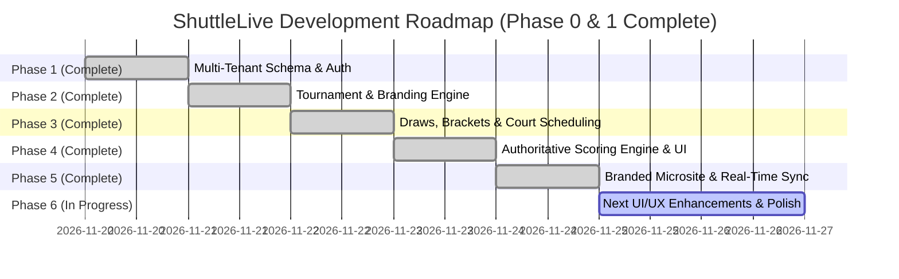

# Implementation Plan & Quality Assurance Test Suite
## Badminton Live (ShuttleLive) — Multi-Tenant & Custom Branding Release

**Document Version:** 1.4.0  
**Status:** Implemented Baseline — Phase 0 & Phase 1 Complete  
**Target Window:** Core MVP Launch & Post-Launch UI/UX Polish

---

## 1. Phased Development Roadmap

### Phase 1: Multi-Tenant Architecture & Auth — COMPLETED [x]
- [x] Initialize Supabase project; apply migration with `organizations`, `tournaments`, `tournament_branding`, `matches`, `match_events`.
- [x] Deploy PostgreSQL Stored Procedure `record_point_event()` for atomic, server-authoritative scoring.
- [x] Deploy PostgreSQL Stored Procedures `undo_point_event()`, `start_match()`, `start_next_game()`, `finalize_match()`, `terminate_match()`.
- [x] Enable PostgreSQL `pg_trgm` extension for fuzzy platform search.
- [x] Configure Supabase Row Level Security (RLS) policies for cross-tenant isolation (owner-only writes, public read of published tournaments).
- [x] Setup Supabase Storage buckets: `tournament-assets`, `organization-assets`, `player-avatars` with public read policies.
- [x] Implement Supabase Auth (Email/password and Google OAuth). No separate insecure umpire PIN in Phase 0.
- [x] Build Organization Workspaces (`/dashboard/orgs`) with `OWNER` and `ORGANIZER` roles and one-time token invite links (`/invite/[token]`).

### Phase 2: Tournament Creation & Branding Studio — COMPLETED [x]
- [x] **[P0]** Build Generic Tournament Creation Wizard (Independent of specific college branding).
- [x] **[P0]** Implement Logo & Cover Banner upload to Supabase Storage with on-the-fly Image Transformation (`?width=400&format=webp`).
- [x] **[P0]** Implement unique slug generation and reservation system (`/t/[slug]`).
- [x] **[P0]** Implement Player & Team creation (Singles and Doubles pair builder) with table view.
- [x] **[P0]** Implement Category rules presets (`BWF_STANDARD` 3x21, `BAI_DOMESTIC` 3x15, `QUICK_21`, `SHORT_15`).
- [x] **[P1]** Implement Appearance Studio color picker with WCAG 2.1 AA luminance contrast auto-correction.
- [x] **[P1]** Implement Sponsors & Partners upload strip (Title, Associate, Powered-By).
- [x] **[P1]** Implement Venue Google Maps embed and 1-tap "Get Directions" link.
- [x] **[P1]** Implement Printable Stadium QR Code Posters (`/dashboard/t/[id]/poster`).

### Phase 3: Draws, Bracketing & Scheduling — COMPLETED [x]
- [x] **[P0]** Implement Knockout bracket generator with power-of-2 byes calculation.
- [x] **[P0]** Implement Manual Fixture creation and bracket slot assignment.
- [x] **[P0]** Implement Court scheduling with double-booking prevention.
- [x] **[P0]** Implement Player scheduling overlap warning.
- [x] **[P1]** Implement Standalone Quick Matches (`/dashboard/quick`) for instant unlisted games without tournament setup.

### Phase 4: Scoring Engine & Organizer Scoring Console — COMPLETED [x]
- [x] **[P0]** Connect unified command endpoint `POST /api/matches/:matchId/events` to Supabase `record_point_event()` RPC.
- [x] **[P0]** Implement authoritative scoring state machine (BWF 3x21 + BAI 3x15, deuce, cap, intervals).
- [x] **[P0]** Implement append-only `UNDO` rollback mechanism via `undo_point_event()` without data deletion.
- [x] **[P0]** Implement `MATCH_WON_PENDING` confirmation state.
- [x] **[P0]** Build mobile-first single-tap organizer scoring console ($>48\text{px}$ touch targets).
- [x] **[P0]** Implement optimistic concurrency versioning (`expectedVersion`, `clientEventId`, `409 Conflict`).
- [x] **[P0]** Handle Walkover, Retirement, and Disqualification termination protocols.
- [x] **[P1]** Stabilize console layout: fixed-height SaveStatus slot and rest timers to prevent button layout shifts.
- [x] **[P1]** Exact BWF proportional court lines SVG visualizer (`components/court/court-lines.tsx`).

### Phase 5: Branded Public Microsite & Real-Time Sync — COMPLETED [x]
- [x] **[P0]** Build public branded microsite route `/t/[slug]` with custom header, logo, banner, and venue details.
- [x] **[P0]** Render subtle *"Powered by ShuttleLive"* badge in header and footer.
- [x] **[P0]** Implement Tri-Mode Supabase Realtime: Broadcast (<100ms ephemeral updates) + Postgres CDC (canonical updates) + Presence.
- [x] **[P0]** Implement Edge-cached HTTP polling fallback ($2.5\text{s}$ interval).
- [x] **[P0]** Implement WhatsApp 1-tap sharing and dynamic OpenGraph preview cards.
- [x] **[P1]** Implement Post-Event Hall of Fame & Champions Showcase for completed tournaments.
- [x] **[P1]** Implement Cricbuzz-Style Match Center (`/t/[slug]/m/[matchId]`) with modular tabs (Scorecard, Live, Stats, Commentary).
- [x] **[P1]** Implement SVG Lead "Worm" Chart with accessible color tokens (`--side-a: #2a78d6`, `--side-b: #eb6834`), keyboard navigation, and screen-reader table.
- [x] **[P1]** Implement Deterministic Fact-Based Commentary Engine (`lib/commentary.ts`) tracking streaks, comebacks from 4+ points down, intervals, and game points.
- [x] **[P1]** Implement Match Statistics Engine (`lib/match-stats.ts`) calculating rallies, streaks, service hold rates, and lead changes.
- [x] **[P1]** Implement Athletic Scoreboard Typography (`app/theme.css` with Barlow and Barlow Condensed).

---

## 2. Launch Acceptance QA Checklist (28 Test Cases)

| Test ID | Area | Scenario / Action | Expected Result | Status |
| :---: | :--- | :--- | :--- | :---: |
| **TC-01** | Scoring | Score reaches 20–20 in 3x21 format. | Game enters deuce; indicates "Win by 2 points". | ✅ PASS |
| **TC-02** | Scoring | Score reaches 21–20 in deuce. | Game continues; 21 is NOT declared winner. | ✅ PASS |
| **TC-03** | Scoring | Score reaches 22–20 in deuce. | Game finishes cleanly; Side A declared Game 1 winner. | ✅ PASS |
| **TC-04** | Scoring | Score reaches 29–29; Side A scores next (30–29). | Game finishes immediately on sudden death cap (30 pts). | ✅ PASS |
| **TC-05** | Scoring (BAI) | 3x15 format: score reaches 20–20; Side B scores (21–20). | Game finishes immediately on BAI cap of 21 points. | ✅ PASS |
| **TC-06** | Service | Game 1 won by Side A; Game 2 begins. | Side A serves first in Game 2 from Right Service Court. | ✅ PASS |
| **TC-07** | Undo Engine | Organizer scores 21st game-winning point, then clicks Undo. | Score rolls back to 20–19; game reopens cleanly; no data lost. | ✅ PASS |
| **TC-08** | Undo Engine | Organizer scores match-winning point; clicks Undo before confirm. | Match rolls back from `MATCH_WON_PENDING` to `LIVE`. | ✅ PASS |
| **TC-09** | Concurrency | Client sends 2 identical requests with same `client_event_id`. | Second request returns cached 200 OK; point NOT counted twice. | ✅ PASS |
| **TC-10** | Persistence | Organizer refreshes mobile browser tab at 14–11. | UI reloads exactly at 14–11 with matching serving side. | ✅ PASS |
| **TC-11** | Offline Mode | Scorer internet drops; 2 points entered; internet restores. | Events replay sequentially with version validation. | ✅ PASS |
| **TC-12** | Security | Unauthenticated visitor POSTs to `/api/matches/:id/events`. | HTTP 401/403 Forbidden; database mutation blocked by RLS. | ✅ PASS |
| **TC-13** | Privacy | Unlisted tournament created; user searches in global search. | Unlisted tournament is omitted from search results. | ✅ PASS |
| **TC-14** | Access | Tournament is in `DRAFT` status; public visits direct link. | Clean 404 / Access Denied page presented. | ✅ PASS |
| **TC-15** | Brackets | 10 entries registered; Knockout bracket generated. | 16-slot bracket generated with exactly 6 byes to top seeds. | ✅ PASS |
| **TC-16** | Bracket Adv. | Match finalized in Quarterfinals. | Winner immediately advances into Semifinal fixture. | ✅ PASS |
| **TC-17** | Scheduling | Attempt to start Match 2 on Court 1 while Match 1 is `LIVE`. | Blocked with warning: "Court 1 is currently occupied". | ✅ PASS |
| **TC-18** | Scheduling | Schedule Player A on Court 1 and Court 2 simultaneously. | System displays scheduling conflict warning for Player A. | ✅ PASS |
| **TC-19** | Walkover | Player absent before match; Walkover declared. | Opponent advances cleanly; no artificial "21-0" score recorded. | ✅ PASS |
| **TC-20** | Spectator | Score updated by organizer from the console. | Spectator view updates in $< 800\text{ms}$ without page reload. | ✅ PASS |
| **TC-21** | Branding | Tournament with custom logo and banner loaded. | Header renders uploaded assets with "Powered by ShuttleLive". | ✅ PASS |
| **TC-22** | Degradation | Tournament created without sponsors, rules, or prizes. | Public page cleanly collapses those sections without blank gaps. | ✅ PASS |
| **TC-23** | Slug Routing | User creates tournament with reserved slug `admin` or `api`. | Blocked with error: "Slug is reserved by the platform". | ✅ PASS |
| **TC-24** | Redirect | Organizer renames slug from `mit-2026` to `mit-sports-2026`. | Visiting `/t/mit-2026` automatically issues HTTP 301 redirect. | ✅ PASS |
| **TC-25** | Multi-Tenancy | Organizer A attempts to modify Tournament B. | HTTP 403 Forbidden enforced by Supabase RLS. | ✅ PASS |
| **TC-26** | Non-Destructive | Organizer updates banner & venue while Match 1 is LIVE. | Branding updates immediately; live match continues uninterrupted. | ✅ PASS |
| **TC-27** | Asset Security | User attempts to upload `.exe` or 15MB file to banner bucket. | Rejected immediately by MIME and byte size validator. | ✅ PASS |
| **TC-28** | Post-Event | Tournament status set to `COMPLETED`. | Microsite prominently displays Champions Podium and final stats. | ✅ PASS |

---

## 3. Organizer Confirmation Checklist for Pilot Tournament

Before match day commences, confirm the following with the pilot event organizers:

1. **Tournament Branding Assets:** Gather Tournament Title, Subtitle, Logo image, Cover banner image, and Host Entity name.
2. **Venue Information:** Exact court location name, address, and Google Maps pin link.
3. **Scoring Preset:** Confirm whether standard 3x21 or BAI domestic 3x15 will be used for games.
4. **Draw Format:** Confirm whether paper fixtures already exist (manual entry) or automatic bracket generation is desired.
5. **Courts & Scoring:** Total physical courts, and who will score from the organizer account on match day.

---

## 4. Next UI/UX Enhancement Plan

The following concrete UI/UX enhancement track is formulated to elevate ShuttleLive to world-class sports broadcast standards:

### Track A: Umpire Console Ergonomics & Court Accessibility
1. **Haptic Feedback (Web Vibration API):** Trigger distinct vibration pulses on mobile devices when tapping `+1 Point` (short 25ms pulse) and `Undo` (double 40ms pulse) so umpires receive physical confirmation without taking their eyes off the court.
2. **High-Contrast Outdoor Sun Glare Mode:** A 1-tap toggle switching the console into pure black-on-white (`#000000` / `#FFFFFF`) mode with ultra-thick high-contrast borders for outdoor court conditions under direct midday sunlight.
3. **Large Swipe Gestures:** Enable full-screen thumb swipe gestures (swipe right to award Side A, swipe left for Side B, swipe downward for Undo).
4. **Interval & Game-Point Audio Chime:** Optional subtle audio cue/buzzer at 11-point interval and game point to alert court officials.

### Track B: Cricbuzz-Style Match Center Spectator Experience
1. **Live Momentum Bar:** Render a dynamic momentum bar showing which player won the majority of the last 5 rallies (e.g., Side A 80% momentum).
2. **Interactive Court Rally Visualizer:** Mini court diagram dynamically showing the active server and receiver based on the current score (Odd = Left Court, Even = Right Court) in Singles and Doubles.
3. **Live Audience Count (Presence Badge):** Real-time spectator count pill powered by Supabase Presence (e.g., "👀 48 watching live").
4. **Head-to-Head & Form Guide Modal:** Tapping a player's name opens their recent match history and tournament statistics.

### Track C: Interactive Knockout Bracket Canvas
1. **SVG Pan/Zoom Gesture Canvas:** Allow spectators on both desktop and mobile to smoothly pan, drag, and pinch-to-zoom across large 32-player or 64-player knockout trees.
2. **Live Court Pulsing Connectors:** Connector lines for matches currently in progress pulse with an active brand color glow, making it immediately apparent which matches are live.
3. **Printable Bracket Sheet:** Dedicated 1-click clean vector print stylesheet for tournament director desks.

### Track D: Fullscreen Stadium / Gymnasium Projector Mode
1. **Dedicated Projector Route (`/t/[slug]/projector`):** Ultra-large typography view specifically designed for gym LED screens, projectors, and stadium monitors.
2. **Multi-Court Split-Screen View:** Display 2, 4, or 6 courts simultaneously in a responsive grid.
3. **Rotating Sponsor Loop:** Gracefully cycles title and associate sponsor logos in the lower-third banner every 15 seconds.

### Track E: Delight & Micro-Animations
1. **Tabular Flip Counter:** Smooth spring/flip animation when score digits change (`18` -> `19`).
2. **Match Point Victory Confetti:** Dynamic celebratory canvas confetti burst when the organizer confirms the final match victory.
